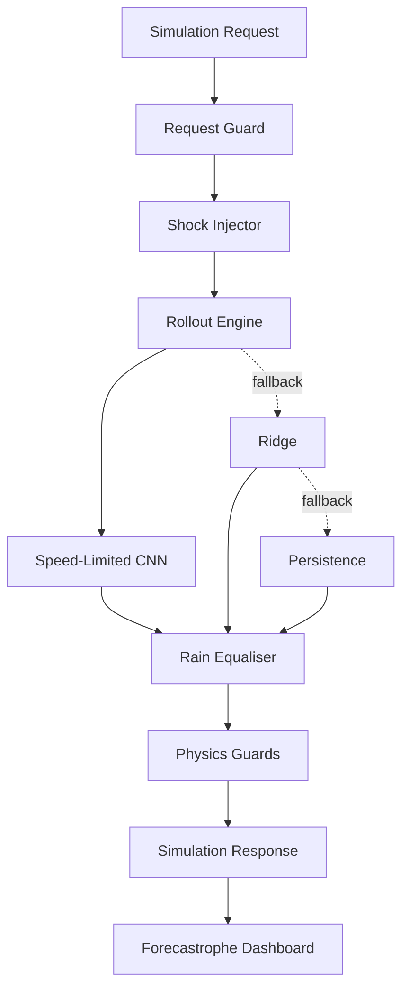

# CodeBlooded — Multiverse of Monsoon
### Yugaantar DevForge · Track 2

A fast, physically constrained digital twin of India's daily weather. Given 3 days of state, it rolls weather forward day by day and propagates localized shocks (a warmer Bay of Bengal, weaker monsoon winds) locally before spreading outward at a bounded speed. Includes **Forecastrophe**, an offline 3D dashboard driven live by the model.

---

## Judge Overview

| Criterion | Requirement / Verification Target |
|---|---|
| **Forecast horizon** | Autoregressive rollout up to 14 steps |
| **Input state** | 3 days · 6 channels · 32 × 36 grid |
| **Output** | `[steps, 6, 32, 36]` · float32 |
| **Channel order** | t2m, tp, u10, v10, msl, tcwv |
| **Rollout stability** | 14-step rollout on 100 windows; valid at every step |
| **Numerical validity** | Finite outputs; rainfall ≥ 0; t2m within 233.15–333.15 K |
| **Forecast skill** | Beat persistence at Day 4; measure skill against persistence and climatology |
| **Mean skill target** | ≥ 0.12 |
| **Rain CSI skill target** | ≥ 0.10 |
| **Anti-blur** | Day-8 variance ratio: 0.4–2.5 across all 6 channels |
| **Shock causality** | Localized response, bounded propagation and stable rollout |
| **Null shock** | No-shock vs null-shock difference within the kit tolerance |
| **Inference latency** | 10-step call under 5 seconds; operational target maximum under 2 seconds |
| **Memory** | Under the 6 GB grader limit |
| **Execution** | CPU-only · offline · read-only repository |
| **API validity** | Invalid inputs handled with HTTP 422, never an unhandled 500 |
| **Bundle integrity** | `python tools/check_bundle.py` → `BUNDLE OK` |
| **Repository scan** | 15/15 · zero flags · inference files restricted to server |
| **Automated tests** | `pytest` |
| **Operational checks** | `python eval/ops_checks.py` |

<sub>These are judge acceptance criteria and verification targets, not a declaration that every gate has already passed on the final trained checkpoint. Final measured results are recorded separately in the evaluation outputs.</sub>

---

## Architecture

### System flow



### Inference pipeline

1. **Request guard** — validates simulation inputs, dimensions, steps and perturbations.
2. **Shock injector** — applies localized or judge-defined perturbations to the initial state.
3. **Rollout engine** — predicts daily state changes using the speed-limited CNN.
4. **Fallback chain** — Ridge and persistence preserve valid inference if a higher-level model fails.
5. **Rain equaliser** — season- and lead-specific rainfall correction with a dry-spell guard.
6. **Physics guards** — enforce numerical and physical validity.
7. **Response** — returns the rollout, timing and diagnostics.

### Model design

- **Speed-limited CNN:** 4 residual blocks with 3 × 3 convolutions; information propagation is bounded to 8 grid cells per daily step.
- **Residual prediction:** predicts state changes rather than reconstructing the entire state.
- **Separate rainfall head:** handles rainfall prediction independently.
- **Rollout training:** trained on its own 1 → 4 → 8-step rollouts.
- **Fallbacks:** CNN → Ridge → persistence.
- **CPU inference:** no GPU dependency at inference time.

The bounded spatial reach constrains how quickly a shock can influence distant grid cells, supporting the locality and propagation checks.

---

## Validation Metrics

### Forecast skill and stability

| Test | Acceptance criterion |
|---|---|
| D1 — Day-4 persistence | Mean skill against persistence at Day 4 > 0 |
| D2 — Forecast skill | Record mean skill against the best reference; target ≥ 0.12 |
| D3 — CNN vs Ridge | CNN mean skill > Ridge mean skill, otherwise ship Ridge |
| D4 — Seasonal/channel skill | No channel-season combination below 0 against the best reference |
| D5 — Long rollout | 14-step rollout on 100 windows; valid at every step |
| D6 — Edge vs interior | Record the skill difference between edge and interior grid cells |
| Numerical validity | No NaN/Inf; rainfall non-negative; temperature within physical envelope |
| Anti-blur | Day-8 variance ratio of 0.4–2.5 on all 6 channels |

Forecast evaluation uses the held-out 2020–21 period and the organisers' scoring functions.

### Shock causality

| Test | Acceptance criterion |
|---|---|
| Day-1 locality | At least 60% of response energy within 3 cells |
| Propagation | Response radius grows without exceeding 8 cells per day |
| Teleport limit | Under 5% of response energy beyond the permitted reach of 8 cells/day + 3 |
| Stability | Perturbed rollout remains within 5 standard deviations |
| Causality pass rate | All causality conditions pass in at least 90% of validation windows |

### Shock scenarios

| Scenario | Perturbation | Verification |
|---|---|---|
| `warm_ocean` | +3 K and +15% moisture over the Bay of Bengal | Localized Day-1 response; propagation; stability |
| `monsoon_stall` | u10/v10 reduced by 40% over the Arabian Sea | Localized response and downstream propagation |
| Random Judge Shock | Judge-defined shock | Valid output, bounded response and stable rollout |
| Null shock | No perturbation | Baseline equivalence |

### Rain equaliser

| Test | Acceptance criterion |
|---|---|
| E1 — Rain CSI | Compare CSI skill at 10 mm with and without equalisation |
| E2 — Day-8 variance | Variance ratio ≥ 0.4 with the equaliser |
| E3 — Rain RMSE / total score | Equaliser configuration must improve total score over the disabled variant |
| E4 — Leakage | Equaliser fitted on 2019 only; test years never used for fitting |
| E5 — Monotonicity | Quantile mapping tables are monotonic |
| E6 — Locality | No pointwise effect outside the changed cells |
| E7 — Resilience | Missing or corrupt tables disable equalisation safely |

The equaliser corrects the output only. Unequalised rainfall is fed back into the next rollout step, keeping calibration separate from the model dynamics.

---

## Judge Verification

### 1. Bundle integrity

```bash
git lfs install
git lfs pull
python tools/check_bundle.py
```

Expected successful bundle verification:

```text
BUNDLE OK
```

A fresh clone must contain the actual trained weights, not Git LFS pointer files.

### 2. Start the server

```bash
python serve.py --port 8000
```

The server must be ready before simulation requests are issued.

### 3. Health check

Open a second terminal:

```bash
curl http://localhost:8000/health
```

Verify that the service reports readiness after its warm-up rollout succeeds.

### 4. API contract

Run the organisers' validator against the live server:

```bash
python -m monsoon_r1.schema_validator http://localhost:8000
```

Expected result:

```text
all checks passed
```

### 5. Operational checks

```bash
python eval/ops_checks.py
```

This verifies operational conditions including inference performance, memory, offline operation, repository integrity and the API contract.

### 6. Automated tests

```bash
pytest
```

### 7. Local scoring evaluation

```bash
python eval/local_score.py --data data/india_climate_train.nc --out eval/results.json
```

This evaluates forecast skill and the associated model-quality gates using the local scoring implementation.

---

## Operational & Edge-Case Validation

| Test | Verification target |
|---|---|
| Invalid steps | 0, −1, 31, malformed or null values handled with HTTP 422 |
| String steps | `"10"` accepted |
| Invalid input shape | Rejected with a clear 422 |
| Invalid perturbation shape | Rejected with a clear 422 |
| Invalid day-of-year encoding | Rejected with 422 |
| NaN/Inf in input state | Repaired and recorded in diagnostics |
| NaN/Inf in perturbation | Handled deterministically |
| Lists vs Base64 | Identical outputs for equivalent inputs |
| Malformed JSON / missing keys | 422; never unhandled 500 |
| Extreme temperature shock | +50 K; valid response, no crash |
| Extreme wind shock | −90% winds; valid response |
| Extreme moisture shock | Moisture × 6; valid response |
| Random noise shock | 5 standard deviations; valid response |
| Extreme pressure shock | −5,000 Pa; valid response |
| Whole-map temperature shock | +10 K; valid response |
| 14-step rollout | Valid at every step |
| CNN unavailable | Ridge fallback |
| CNN and Ridge unavailable | Persistence fallback |
| Equaliser unavailable | Equaliser disabled safely |
| CNN exception | Ridge fallback; logged |
| CNN NaN output | Ridge fallback; logged |
| CNN slow inference | Switch to Ridge within the internal time budget |

---

## Performance & Offline Constraints

The inference service is designed to run within the organisers' sandbox:

- CPU-only inference; no CUDA/GPU requirement.
- No internet access required during inference.
- Read-only repository; writes restricted to permitted temporary locations.
- 4 CPU cores and 6 GB RAM sandbox.
- 10-step response within the 5-second limit, including serialization.
- Operational target: maximum under 2 seconds across 20 back-to-back 10-step calls.
- Peak memory below 6 GB.
- `/health` readiness within 120 seconds.
- Inference weights load on CPU.
- No weather API calls, date lookups or external data fetching during inference.

The operational checks are intended to verify these conditions in an offline environment.

---

## Repository Integrity

| Check | Acceptance criterion |
|---|---|
| Repository scan | 15/15 points, zero flags |
| Inference file scope | Only `serve.py` and `server/` |
| Trained checkpoint | `cnn.pt` larger than 1,024 bytes and committed through Git LFS |
| Fresh clone | Actual model files, no LFS pointers |
| Dataset files | No `.nc` files committed |
| Server code | No date strings or external weather URLs |
| Read-only execution | Repository remains unchanged after operational checks |

---

## Forecastrophe — Dashboard Validation

Forecastrophe is an offline 3D dashboard driven by the live simulation API.

### Dashboard run

Generate the starting presets:

```bash
python tools/make_presets.py --data data/india_climate_train.nc
```

Terminal 1 — start the API:

```bash
python serve.py --port 8000
```

Terminal 2 — start the dashboard:

```bash
cd dashboard
python -m http.server 8080
```

Open:

http://localhost:8080

### Dashboard checks

| Test | Verification |
|---|---|
| Live integration | Dashboard uses live `/simulate` output |
| Starting weather | 7 starting days available |
| Presets | All 7 presets verified |
| `warm_ocean` | Shock and difference maps work |
| `monsoon_stall` | Shock and difference maps work |
| Random Judge Shock | Judge-defined shock runs without crashing |
| Null test | Baseline comparison works |
| Prime view | Forecast timeline renders |
| Difference view | Shock-minus-baseline maps render |
| Response-radius chart | Matches causality-test results |
| Impact maps | Update with live simulation outputs |
| Diagnostics | Model and fallback diagnostics visible |
| Server down | Shows model unavailable; no stale cached images |
| Offline operation | No CDN or external service dependency |

---

## Project Structure

```text
CodeBlooded/
├── serve.py
├── server/
│   ├── core.py
│   └── bundle/
│       ├── cnn.pt
│       ├── ridge.npz
│       ├── qm.json
│       ├── meta.json
│       └── static.npy
├── train/
│   └── pipeline.py
├── eval/
│   ├── local_score.py
│   ├── ops_checks.py
│   └── lo_up.py
├── tests/
├── tools/
│   ├── check_bundle.py
│   ├── set_equaliser.py
│   └── make_presets.py
├── kaggle/
│   ├── train_on_kaggle.ipynb
│   └── train_local_cpu.ipynb
├── dashboard/
├── data/
├── requirements.txt
├── requirements-dev.txt
└── README.md
```

| Path | Responsibility |
|---|---|
| `serve.py` | API entry point; organiser contract |
| `server/core.py` | Rollout, shocks, rain equaliser, physics guards and fallbacks |
| `server/bundle/` | Trained weights and supporting assets via Git LFS |
| `train/pipeline.py` | Model training pipeline |
| `eval/local_score.py` | Local scoring evaluation |
| `eval/ops_checks.py` | Operational and grader-condition checks |
| `eval/lo_up.py` | Offline loopback helper |
| `tests/` | Contract, validity, determinism, shock and fallback tests |
| `tools/check_bundle.py` | Bundle integrity verification |
| `tools/set_equaliser.py` | Rain equaliser control |
| `tools/make_presets.py` | Dashboard starting-state generation |
| `kaggle/` | Training notebooks |
| `dashboard/` | Forecastrophe frontend and offline assets |
| `data/` | Local climate data; not committed |

---

## Data

The required dataset and statistics file are available from the organisers' kit release:

[ yug-monsoon-kit v1.0.0 ](https://github.com/OfficialAbhinavSingh/yug-monsoon-kit/releases/tag/v1.0.0)

Place the following in `data/`:

- `india_climate_train.nc`
- `stats.json`

The data directory is git-ignored and the dataset is never committed to the repository.

---

## Training

Training and evaluation are separated from the inference service.

- Training years: 2005–2018.
- Validation year: 2019.
- Held-out evaluation: 2020–2021.
- CNN training: multi-step rollout curriculum.
- Rain equaliser: calibrated using validation forecasts.
- Final evaluation: organiser scoring functions on held-out years.

### Training notebooks

- `kaggle/train_on_kaggle.ipynb` — GPU training.
- `kaggle/train_local_cpu.ipynb` — CPU backup.

Training artifacts are placed in `server/bundle/` and committed using Git LFS.

---

## Team

- **Bhoomi** — Repository and integration
- **Vaishnavi** — Model training and review
- **Joel** — Dashboard

---

## Credits

API contract, scoring functions, validator and starter components are based on the organisers' kit (MIT).

Design draws on:

- Rasp & Thuerey (2021)
- Keisler (2022)
- Choudhury et al. (BharatBench, 2024)
- Hakim & Masanam (2024)

All model, server, training and dashboard code written by the team.
