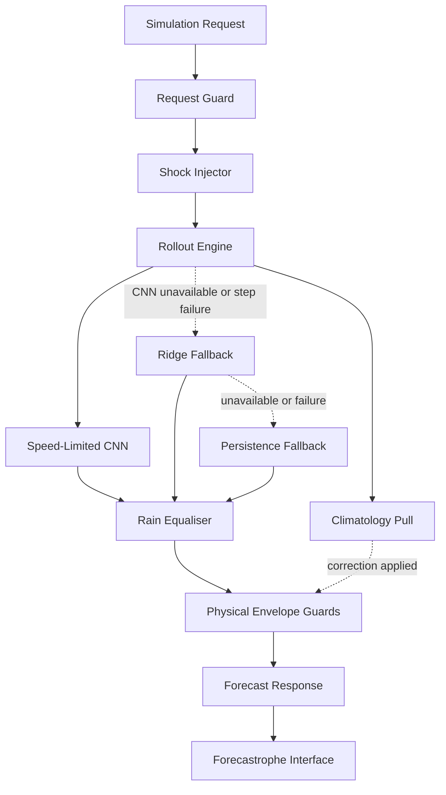

# CodeBlooded — Multiverse of Monsoon
### Forecastrophe
### Yugaantar DevForge · Track 2

Multiverse of Monsoon is a speed-limited, physically guarded daily-weather emulator for India. It forecasts forward from three days of weather-grid state and allows localized what-if perturbations—such as warming a region or weakening winds—to be injected into the initial state and propagated through the forecast.

The core is a compact CNN-based rollout system designed around bounded spatial influence, operational resilience and measurable forecast skill. Forecastrophe is the accompanying visualization and exploration interface; it is a way to inspect the model and compare baseline and perturbed forecasts, not the project's central contribution.

---

## At a glance

| | |
|---|---|
| **Input** | 3 consecutive days of weather state |
| **Grid** | 32 × 36 |
| **Channels** | 6 physical variables |
| **Forecast horizon** | The simulation engine supports up to 30 daily rollout steps; Forecastrophe is configured for up to 14 days |
| **Core model** | Speed-limited residual CNN, with Ridge and persistence fallback paths |
| **Shock experiments** | Localized physical perturbations applied to the final input day |
| **Inference** | CPU-only, offline, with a compact bundled model |
| **Evaluation** | A local replica of the organiser scoring workflow plus contract, validity, shock and fallback tests |

---

## System architecture

The simulation request passes through a single supervised pipeline. Model fallback occurs within the rollout stage; output correction and physical bounds are applied before the response is returned.



### Pipeline stages

- **Request guard** — checks the initial-state shape, forecast-step count, seasonal input and perturbation shape; repairs non-finite input values where possible.
- **Shock injector** — applies the physical perturbation to the most recent input state and clips it to the physical envelope.
- **Rollout engine** — advances the state one day at a time. The CNN is primary, Ridge is the fallback, and persistence is the final fallback.
- **Rain equaliser** — applies a seasonal, lead-dependent, land/sea-aware monotone quantile mapping to rainfall, with a dry-spell guard.
- **Climatology pull** — blends forecasts toward a fitted seasonal climatology according to lead/channel weights. For shocked runs, the correction is based on the unshocked forecast so the perturbation response remains attributable to the model's dynamics.
- **Physical envelope guards** — repairs/clips values to the configured variable bounds before returning the rollout.

---

## Model design

### Residual CNN

The CNN is designed to constrain how far spatial information can travel during one daily prediction step.

- 4 residual blocks
- 2 × 3×3 convolution layers per residual block
- 96 feature channels (width)
- 25 input channels: 18 channels from the three input days (3 × 6), 5 static channels and 2 seasonal channels
- Residual prediction heads: a state-change head for five variables and a separate rainfall head
- Spatial reach: up to 8 grid cells per daily step from the residual blocks

The residual state head predicts scaled day-to-day changes rather than directly reconstructing the full state. Rainfall is predicted through its separate head and handled in log-normalized space during model processing.

### Fallback chain

The service does not depend on the CNN being available for every forecast step.

| Model | Role |
|---|---|
| CNN | Primary learned rollout model |
| Ridge | Fast alternative model when the CNN is unavailable, fails or the call exceeds its time budget |
| Persistence | Last-resort fallback that repeats the most recent state |

The server records which model was used for each forecast step in its diagnostics.

---

## Evaluation

The repository includes `eval/results.json`, generated by the local scoring replica. The results below are from the checked-in report, using 144 evaluation windows. They are not an official organiser score.

### Forecast metrics

| Metric | CNN + rain equaliser |
|---|---:|
| Evaluation windows | 144 |
| Invalid forecast windows | 0 |
| Mean forecast skill | 0.1132 |
| Mean rainfall CSI skill | 0.1002 |
| Forecast points (replica) | 43.30 / 45 |
| RMSE component | 28.30 / 30 |
| CSI component | 15.00 / 15 |
| Day-8 anti-blur component | 10.00 / 10 |
| Day-4 skill vs persistence | +0.2718 |
| Day 4 beats persistence | Yes |
| Total automatic replica score | 67.05 / 70 |

<sub>The 70-point total is the local replica's automatic component (forecast + anti-blur + causality), not the overall competition score. The local evaluator's assumptions are documented in `eval/local_score.py`.</sub>

### Day-8 variance ratios

The mean forecast-to-observation variance ratios by channel in the checked-in evaluation report:

| Channel | Ratio |
|---|---:|
| t2m | 0.998 |
| tp | 0.614 |
| u10 | 0.782 |
| v10 | 0.782 |
| msl | 0.924 |
| tcwv | 0.903 |

These values are included as a variance-preservation check rather than as standalone accuracy measures.

### Inference latency

| Metric | Reported value |
|---|---:|
| Mean inference latency | 36.5 ms |
| Maximum inference latency | 49.2 ms |

Latency values are from the checked-in local evaluation report and depend on the evaluation environment.

### Shock-response and causality checks

The evaluator checks whether responses are non-zero, localized, stable, non-teleporting and propagate over time. The checked-in report shows:

| Check | Warm-ocean shock | Monsoon-stall shock |
|---|---:|---:|
| Non-zero response | 100% | 100% |
| Localized | 100% | 100% |
| Propagates (pass rate) | 95.8% | 37.5% |
| Stable | 100% | 100% |
| No teleporting | 100% | 100% |
| Day-1 response energy within local neighbourhood | 96.9% | 98.9% |

<sub>Propagation is a harder check than immediate locality: the monsoon-stall shock's propagation pass rate is 37.5% in this report. These results are reported as-is rather than treating all causality gates as passed.</sub>

The 90%-response-energy radius (in grid cells from the shock region) also grows over forecast lead in the evaluation report, rather than showing a uniformly instantaneous global response.

### Baselines

The local replica compares the candidate against persistence, climatology and Ridge, in addition to the CNN without the rain equaliser. See `eval/results.json` for the full comparison. In the checked-in report, the CNN and CNN + rain equaliser rows have the same reported forecast/causality components and skill metrics; the equaliser's inclusion is part of the shipped candidate configuration, but the report does not demonstrate an improvement in those particular aggregate values over the raw CNN.

---

## Shock experiments

Perturbations are expressed in physical units and applied to the last input day before rollout. The API accepts a perturbation array with the same six-channel grid structure as one weather state.

The test suite includes shock scenarios such as:

- Regional temperature increase
- Wind reduction
- Moisture increase
- Noise perturbations
- Whole-grid temperature changes
- Pressure reductions

The evaluation also tests the organiser-style warm-ocean and monsoon-stall shocks.

---

## Forecastrophe

Forecastrophe is the browser-based interface for exploring the model's rollouts and shock responses.

- Live forecasts served by the backend
- Starting-weather presets spanning monsoon onset, active monsoon, heavy rain, heat, cyclone scenarios and winter
- Baseline and shocked forecast comparison
- Forecast timeline and day-by-day inspection
- Map-based weather visualization, including 3D map layers and wind visualization
- Difference/impact views, including state-level rainfall change and heat-risk summaries
- Model-step diagnostics and fallback indicators
- Export and presentation-oriented controls

The interface is built with vanilla JavaScript and locally vendored libraries. It does not require a Node build pipeline. It is configured for live mode by default; the mock engine is retained for interface development.

---

## Run the inference server

### 1. Install inference dependencies

```bash
pip install -r requirements.txt
```

### 2. Start the server

```bash
python serve.py --port 8000
```

The service binds to `0.0.0.0` and exposes the organiser contract endpoints:

- `POST /health` — readiness and model name (`GET` is also supported)
- `POST /simulate` — forecast rollout

The model is loaded and warmed up before `/health` reports ready.

---

## Run Forecastrophe with the live model

### 1. Generate starting-weather presets

Place the dataset and statistics file in `data/` (see Data below), then run:

```bash
python tools/make_presets.py --data data/india_climate_train.nc
```

### 2. Start the backend

```bash
python serve.py --port 8000
```

### 3. Start the frontend

In another terminal:

```bash
cd dashboard
python -m http.server 8080
```

Open http://localhost:8080.

---

## Training and verification

Training and evaluation dependencies are separate from inference dependencies.

```bash
pip install -r requirements-dev.txt
```

Training notebooks are provided for Kaggle GPU and local CPU workflows:

- `kaggle/train_on_kaggle.ipynb`
- `kaggle/train_local_cpu.ipynb`

The training pipeline is implemented in `train/pipeline.py`. Its documented data split is:

| Split | Years |
|---|---|
| Training | 2005–2018 |
| Validation / tuning | 2019 |
| Held-out evaluation | 2020–2021 |

The pipeline trains the normalization, Ridge fallback, CNN and rain-equaliser components and produces the model bundle.

### Verification commands

```bash
python tools/check_bundle.py
python eval/local_score.py --data data/india_climate_train.nc --out eval/results.json
pytest
```

`eval/ops_checks.py` contains the operational/grader-conditions check intended to run in a network-isolated namespace against a read-only repository copy. It exercises readiness, the kit schema validator, real 10-step calls, concurrency, memory, repository immutability and repository scanning. This README does not claim a fresh run of that script from the uploaded snapshot.

---

## API contract

### Input

| Field | Description |
|---|---|
| `init_states` | Three days of input state, shape `[3, 6, 32, 36]` |
| `doy_sincos` | Seasonal angle representation: `[sin, cos]` |
| `steps` | Forecast length, 1–30 |
| `perturbation` | Optional physical perturbation, shape `[6, 32, 36]`, or `null` |

The service accepts JSON nested lists and also tolerates a Base64 encoded float32 array with an accompanying shape.

### Output

| Field | Description |
|---|---|
| `rollout` | Forecast array, shape `[steps, 6, 32, 36]` |
| `inference_ms` | Inference duration reported by the server |
| `diagnostics` | Step-by-step model/fallback and service diagnostics |

### Channel order and units

| Index | Channel | Units |
|---|---|---|
| 0 | t2m | K |
| 1 | tp | mm/day |
| 2 | u10 | m/s |
| 3 | v10 | m/s |
| 4 | msl | Pa |
| 5 | tcwv | kg/m² |

### Output envelope

The core clips output to its configured physical envelope:

| Channel | Lower bound | Upper bound |
|---|---:|---:|
| t2m | 234 K | 332 K |
| tp | 0 mm/day | 800 mm/day |
| u10 | -60 m/s | 60 m/s |
| v10 | -60 m/s | 60 m/s |
| msl | 85,000 Pa | 110,000 Pa |
| tcwv | 0 kg/m² | 120 kg/m² |

---

## Tests

`tests/test_edge_cases.py` covers:

- Output shape and numerical validity across multiple forecast lengths
- Invalid step counts and input-shape rejection
- Seasonal input validation
- Non-finite input repair and perturbation sanitization
- Deterministic repeat calls and null-shock equivalence
- Thread-count tolerance
- Shock response behavior and extreme shock validity
- Fallbacks when CNN, Ridge or equaliser files are missing/corrupt
- Fallback when a CNN step fails or becomes non-finite
- Slow inference budget behavior
- Health endpoint and HTTP input validation
- List and Base64 input equivalence
- Response-size limits

The test module requires the dataset and statistics file; if they are absent, the module skips at import time. Shock-quality checks are marked separately in the test suite.

---

## Project structure

```text
CodeBlooded/
├── serve.py
├── server/
│   ├── core.py
│   └── bundle/
│       ├── cnn.pt
│       ├── ridge.npz
│       ├── qm.json
│       ├── meta.json
│       ├── static.npy
│       ├── clim_harmonics.npy
│       └── clim_pull.npy
├── train/
│   └── pipeline.py
├── eval/
│   ├── local_score.py
│   ├── ops_checks.py
│   ├── lo_up.py
│   ├── results.json
│   └── train_log_v2.txt
├── tests/
│   └── test_edge_cases.py
├── tools/
│   ├── check_bundle.py
│   ├── make_presets.py
│   ├── set_equaliser.py
│   └── scenarios.json
├── kaggle/
│   ├── train_on_kaggle.ipynb
│   └── train_local_cpu.ipynb
├── dashboard/
│   ├── index.html
│   ├── config.json
│   ├── js/
│   ├── css/
│   ├── assets/
│   ├── presets/
│   ├── tests.html
│   ├── mock/
│   └── vendor/          # vendored libraries
├── requirements.txt
└── requirements-dev.txt
```

---

## Data

The training and evaluation data are not committed to the repository.

Place the organiser dataset and its statistics file in `data/`:

- `india_climate_train.nc`
- `stats.json`

Dataset release: `yug-monsoon-kit v1.0.0`

The `data/` directory is ignored by Git. Use the provided data release and do not commit the dataset.

---

## Team

- Bhoomi — Repository and Integration
- Vaishnavi — Model Training and Review
- Joel — Dashboard
- Aditya - Testing

---

## Credits

The API contract, scoring functions and validator are from the organisers' kit (MIT). The design draws on Rasp & Thuerey (2021), Keisler (2022), Choudhury et al. (BharatBench, 2024) and Hakim & Masanam (2024).

All model, server, training and dashboard code is written by the team.
