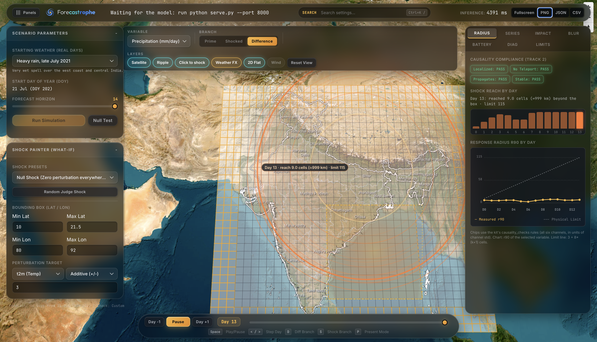
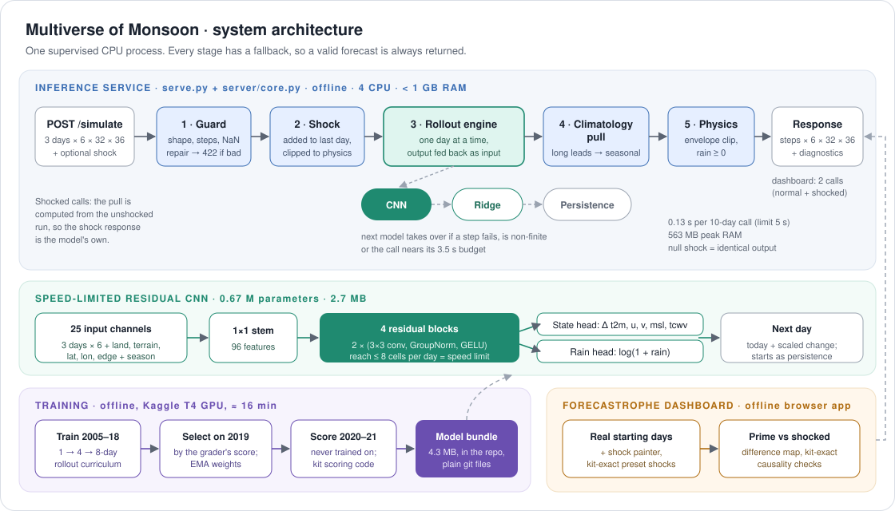
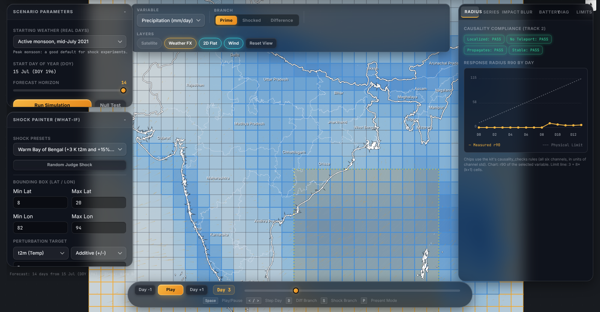
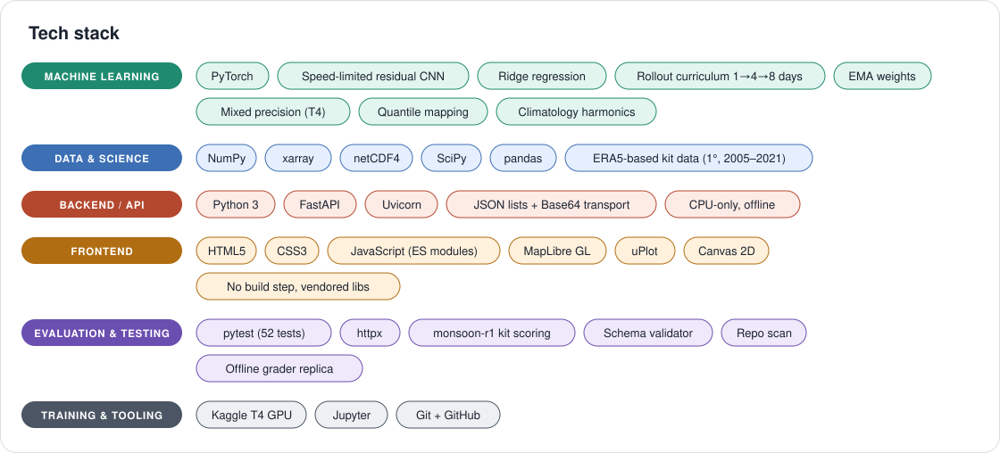

<div align="center">

# Forecastrophe

### A CPU digital twin of India's daily weather that answers *"what if?"*

**Team CodeBlooded · Yugaantar DevForge 2026 · Track 2: Multiverse of Monsoon**

[**Read the brief (PDF)**](docs/brief.pdf) &nbsp;·&nbsp;
[Run it](#for-judges-run-the-model-and-the-dashboard) &nbsp;·&nbsp;
[Architecture](#architecture) &nbsp;·&nbsp;
[Results](#results) &nbsp;·&nbsp;
[Dashboard](#forecastrophe-dashboard) &nbsp;·&nbsp;
[Tech stack](#tech-stack)

</div>

Give it three days of real weather over India and it rolls the weather forward, day by day, on a laptop CPU.
Change the starting state (warm the Bay of Bengal, weaken the Arabian Sea monsoon wind) and the effect starts
where you put it, then spreads outward at a physically bounded speed. It never jumps across the map.

<table>
<tr>
<td align="center" width="20%"><h2>67.05<sub>/70</sub></h2><sub>automatic score on held-out<br>2020–21 (local grader replica)</sub></td>
<td align="center" width="20%"><h2>+27%</h2><sub>more accurate than<br>"tomorrow = today" at day 4</sub></td>
<td align="center" width="20%"><h2>0.13 s</h2><sub>per 10-day forecast<br>on CPU (limit 5 s)</sub></td>
<td align="center" width="20%"><h2>4.3 MB</h2><sub>entire model bundle<br>0.67 M parameters</sub></td>
<td align="center" width="20%"><h2>15/15</h2><sub>organisers' repo scan<br>52/52 tests pass</sub></td>
</tr>
</table>

<p align="center">
  
  <br><sub>Forecastrophe, driven live by the model: the organisers' warm-ocean shock on 15 July 2021, day 3, shocked minus normal.
  The response stays near the Bay of Bengal, and all four causality checks pass.</sub>
</p>

---

## For judges: run the model and the dashboard

**1. Set up (once).** Python 3.11 or newer.

```bash
git clone https://github.com/Bhoomified/Forecastrophe.git
cd Forecastrophe
python3 -m venv .venv
source .venv/bin/activate            # Windows: .venv\Scripts\activate
pip install -r requirements.txt      # numpy, torch, fastapi, uvicorn
```

<sub>Linux without a GPU: `pip install torch --index-url https://download.pytorch.org/whl/cpu` first avoids a multi-GB download.
No data download is needed: the trained weights, normalisation, static maps and climatology are in `server/bundle/`,
and every request carries its own three input days.</sub>

**2. Start the model (terminal 1).**

```bash
python serve.py --port 8000
```

Wait for `Model ready: speed-limited-cnn-w96-b4-v3 [cnn]`. The API is the organisers' contract:
`POST /health` and `POST /simulate` on port 8000.

**3. Open the dashboard (terminal 2).**

```bash
cd Forecastrophe/dashboard      # a new terminal, in the folder you cloned into
python3 -m http.server 8080
```

Open **http://localhost:8080/** in a browser. The header shows the live model name in green, and a forecast for a
real monsoon day appears within a few seconds.

**4. Try a what-if in 30 seconds.**

1. *Shock Painter → Shock Presets → Warm Bay of Bengal*, then **Run Simulation**.
2. Switch the branch to **Difference** and drag the timeline: the warm patch spreads day by day, never jumping.
3. Open the **Battery** tab → **Run Suite**: six physics tests run against the live model (null shock identical, locality, linearity, symmetry).

**5. Optional: the organisers' own checks.**

```bash
pip install -r requirements-dev.txt
python -m monsoon_r1.schema_validator http://localhost:8000      # RESULT: all checks passed
python -c "from monsoon_r1.repo_scan import scan; import json; print(json.dumps(scan('.'), indent=1))"   # points: 15.0
```

---

## Architecture



| Stage | What it does | Why it matters for the score |
|---|---|---|
| **1 · Guard** | Checks shapes, step count and season input; repairs non-finite values; rejects bad requests with 422 | No crashed or invalid call |
| **2 · Shock** | Adds the perturbation to the last input day and clips it to physical limits | Shocks stay physical |
| **3 · Rollout** | Speed-limited residual CNN, one day at a time; ridge, then persistence, take over if a step fails or the call nears its time budget | Every call returns a valid forecast in time |
| **4 · Climatology pull** | At longer leads the forecast leans towards the seasonal average, with strength per lead and channel fitted on 2019 and computed from the day-of-year angle | +2.2 forecast points on held-out years |
| **5 · Physics** | Clips every day to the physical envelope; rain is never negative | Validity gate always passes |

**The speed limit.** Every 3×3 convolution reaches one neighbouring cell. Four residual blocks of two convolutions
therefore reach at most 8 cells (about 900 km) per simulated day. A shock physically cannot teleport: the
warm-ocean response radius grows steadily from 1.3 to 7.2 cells over ten days.

**A shock's effect is the model's own.** For a shocked call, the climatology correction is computed from the
unshocked run, so shocked minus normal is exactly what the network produces. A zero shock returns an identical forecast.

---

## What we built differently

| Known problem in learned weather emulators | Our answer |
|---|---|
| Responses appear instantly far from a perturbation | Receptive field capped at 8 cells per day by design |
| Forecasts blur into a smooth average after a few days | Trained on its own 1 → 4 → 8-day rollouts; day-8 detail stays at 61–100% of reality |
| Rain is skewed, and heavy events get smoothed away | Separate rain head in log space, 3× weight on cells over 10 mm/day |
| One model failure breaks the service | Three-level fallback chain plus a time budget on every call |
| Model chosen by training loss, not by what is scored | Checkpoint picked by the grader's own formula on 2019, with EMA weights |
| Long-range forecasts worse than the seasonal average | Lead-dependent pull towards day-of-year climatology harmonics |

---

## Results

Held-out years 2020–21, never used for training or tuning: 144 forecast windows, scored with the organisers' own
`scoring.py` through [`eval/local_score.py`](eval/local_score.py). Full report: [`eval/results.json`](eval/results.json).

| Model | Total / 70 | Forecast / 45 | RMSE skill / 30 | Heavy-rain CSI / 15 | Anti-blur / 10 | Causality / 15 |
|---|---:|---:|---:|---:|---:|---:|
| Climatology | 10.00 | 0.00 | 0.00 | 0.00 | 10.00 | 0.00 |
| Persistence | 19.58 | 0.00 | 0.00 | 0.00 | 8.33 | 11.25 |
| Ridge (our fallback) | 20.31 | 0.00 | 0.00 | 0.00 | 9.06 | 11.25 |
| **Forecastrophe** | **67.05** | **43.30** | **28.30** | **15.00** | **10.00** | **13.75** |

Mean skill against the better of persistence and climatology is **+0.113** (full RMSE points at +0.12).
Heavy-rain CSI skill is **+0.100** (full points at +0.10).

**Causality**, with the organisers' `causality_checks` (pass rate over test windows):

| Check | Warm Bay of Bengal (+3 K, +15% moisture) | Weaker Arabian Sea wind (−40%) |
|---|---:|---:|
| Localized on day 1 | 100% | 100% |
| No teleport | 100% | 100% |
| Stable (under 5 std) | 100% | 100% |
| Propagates outward | 96% | 38% |
| Null shock identical | yes | yes |

**Under grader conditions** ([`eval/ops_checks.py`](eval/ops_checks.py): no network, read-only copy of the repo):
ready in about 2 s, 0.13 s per 10-day call (about 0.3 s with a shock), 4 parallel calls OK, 563 MB peak memory,
repo unchanged after running, organisers' repo scan 15/15.

---

## Forecastrophe dashboard

<p align="center">
  
  <br><sub>Rain forecast for day 3 from 15 July 2021: the west coast and north-east monsoon belts, straight from the model.</sub>
</p>

An offline browser app with no build step and every library vendored, driven live by the model:

- **Seven real starting days** from the held-out years: active monsoon, onset, heavy rain, heatwave, two cyclones, winter
- **Shock painter**: the organisers' exact preset shocks, or any box, variable and size
- **Prime, shocked and difference views** on a 2D or 3D map, with wind streamlines from the model
- **Live causality checks** with the kit's own rules, response radius by day, and state-level impact
- **Physics battery**: null determinism, locality, linearity and symmetry tests against the live server
- Export to PNG, JSON and CSV

---

## Tech stack



---

## Reproduce the model

```bash
pip install -r requirements-dev.txt
# kit data (not committed): put india_climate_train.nc and stats.json in data/
python tools/check_bundle.py                                                            # bundle complete, model loads
pytest                                                                                  # 52 tests
python eval/local_score.py --data data/india_climate_train.nc --out eval/results.json   # the results table above
```

The shipped model is trained by [`kaggle/train_v3_on_kaggle.ipynb`](kaggle/train_v3_on_kaggle.ipynb) on a Kaggle T4:
about 16 minutes of training, then held-out scoring and the climatology-pull fit. The base pipeline is
[`train/pipeline.py`](train/pipeline.py).

| Split | Years | Used for |
|---|---|---|
| Train | 2005–2018 | Weights, normalisation, climatology |
| Validation | 2019 | Checkpoint choice, climatology-pull strengths |
| Test | 2020–2021 | Every number in this README |

---

## API (organisers' contract)

| Endpoint | Request | Response |
|---|---|---|
| `POST /health` (GET also works) | none | `{"status": "ready", "model_name": ...}` |
| `POST /simulate` | `init_states [3, 6, 32, 36]`, `doy_sincos [sin, cos]` of the last input day, `steps` 1–30, `perturbation [6, 32, 36]` or `null` | `{"rollout": [steps, 6, 32, 36], "inference_ms", "diagnostics"}` |

Nested JSON lists are canonical; base64 float32 is also accepted. Channels and units: t2m (K), tp (mm/day),
u10 (m/s), v10 (m/s), msl (Pa), tcwv (kg/m²).

---

## Repository map

| Path | Contents |
|---|---|
| `serve.py` | API server (FastAPI) on the organisers' contract |
| `server/core.py` | Model, fallbacks, climatology pull, physical guards: the only module `serve.py` imports |
| `server/bundle/` | Trained model files (plain git, 4.3 MB) |
| `train/pipeline.py` | Training pipeline |
| `eval/` | Grader replica, grader-conditions check, results |
| `tests/` | 52 tests: contract, validity, determinism, shocks, fallbacks |
| `tools/` | Bundle checker, preset builder, equaliser switch |
| `kaggle/` | Training notebooks (`train_v3_on_kaggle.ipynb` produced the shipped model) |
| `dashboard/` | Forecastrophe front end |
| `docs/` | Brief, architecture and tech-stack diagrams, screenshots |

---

## Limits we know about

- Daily rain beyond about day 4 is close to the seasonal average: storms are smaller than one 1° cell, and the inputs have no upper-air fields.
- The weaker-monsoon-wind shock spreads outward clearly in only 38% of test windows.
- The organisers score windows after 2023; our numbers are on 2020–21, the latest years in the kit.

---

<div align="center">

**Team CodeBlooded**

Bhoomi · repository and integration &nbsp;|&nbsp; Vaishnavi · model training and review &nbsp;|&nbsp; Joel · dashboard &nbsp;|&nbsp; Aditya · testing

</div>

**Credits.** Data: modified ERA5 reanalysis (Hersbach et al. 2020, CC BY 4.0) via WeatherBench 2, from the organisers' kit.
API contract, scoring functions and validator: organisers' kit (MIT). Design informed by Rasp & Thuerey (2021),
Keisler (2022), Choudhury et al. (BharatBench, 2024) and Hakim & Masanam (2024).
All model, server, training and dashboard code is written by the team.
